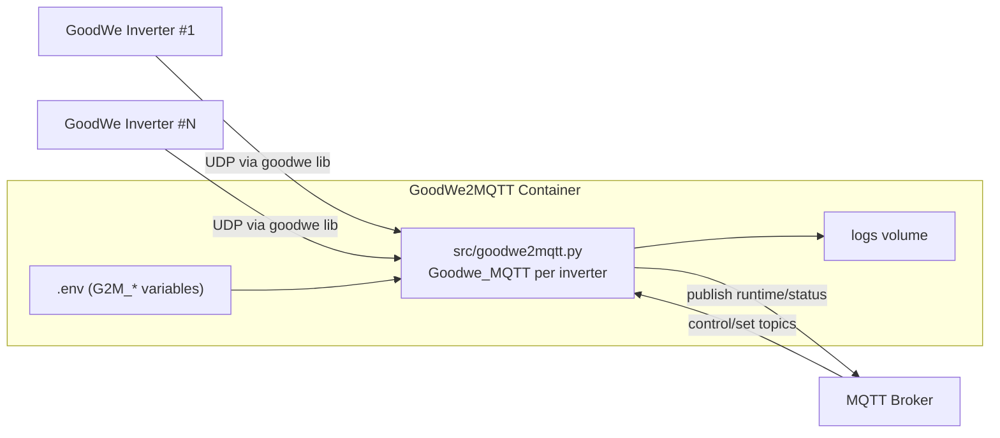

# Architecture

## Repository Layout (Implementation Start)

- `src/`: application implementation modules.
- `goodwe2mqtt.py`, `logger.py`: compatibility entrypoints.
- `docs/`: operator and developer documentation.

## Supported Inverter Families

The bridge talks to the inverter through the `goodwe` library, which supports the ET/EH/BT/BH
(battery hybrid), ES/EM/BP and DT/MS/D-NS/XS (grid-only) families.

By default the family is **not** configured: `goodwe.connect` is called without one and the library
recognises the model tag in the inverter's serial number. Set
`G2M_GOODWE_INVERTERS_<N>_FAMILY` (e.g. `ET` or `DT`) only to pin a family the detection gets wrong.

The bridge adapts to what the connected inverter advertises, as the Home Assistant integration does:

| | ET (hybrid) | DT (grid-only) |
|---|---|---|
| Battery charge/discharge current limits | yes | not offered |
| `work_mode` (operation mode) | yes | not offered |
| EMS mode and power limit | yes | not offered |
| Grid export limit | watts (0–10000 W) | percent of rated power (0–200%) |

Commands for a setting the inverter does not have are rejected and logged rather than passed to the
library. The grid export limit keeps its `grid_export_limit_watts` topic and `/set/` name on both
families; the published payload carries a `unit` field (`"W"` or `"%"`) so a consumer can tell which
one it is reading.

> The library's `DT.read_settings_data()` reads its settings without the per-setting error tolerance
> the ET one has, so a single register the inverter does not implement (`shadow_scan_pv2`, say)
> aborts the whole call. `Goodwe_MQTT.read_settings_data()` falls back to reading each advertised
> setting individually, and a failed settings read no longer blocks runtime data from being
> published — settings are logged only.
